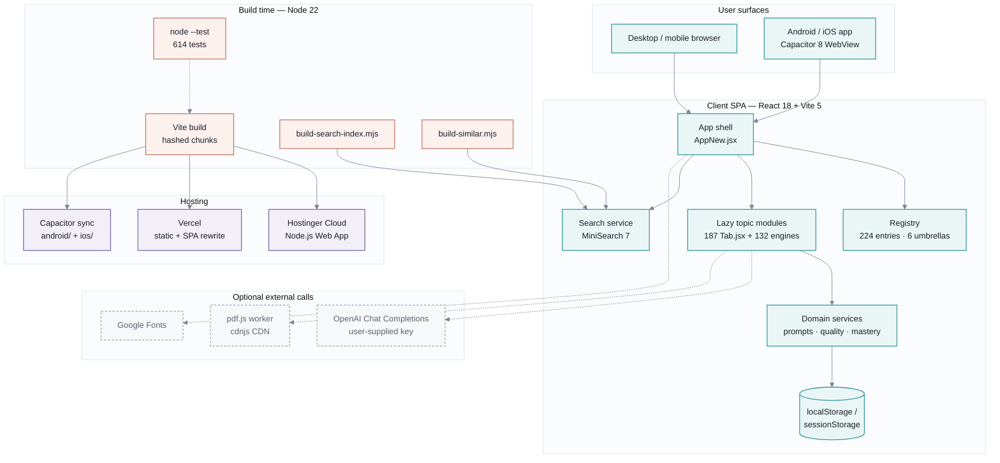
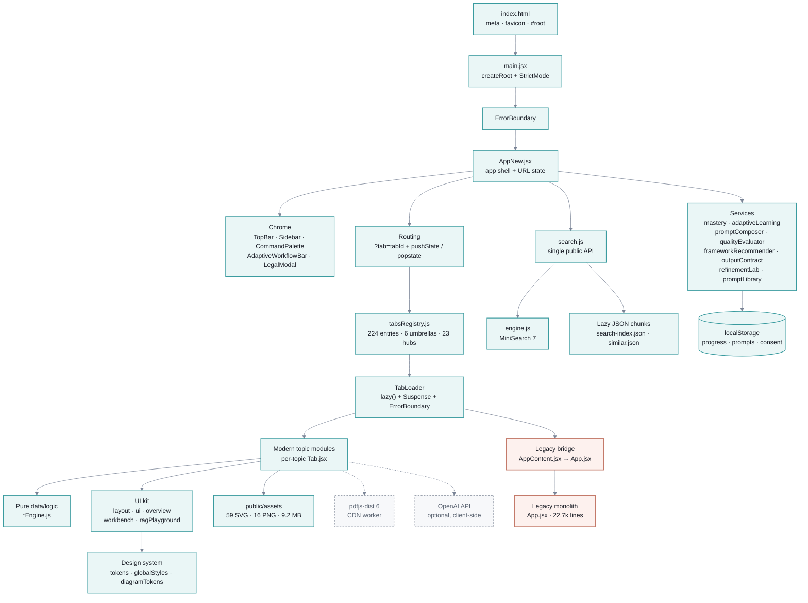
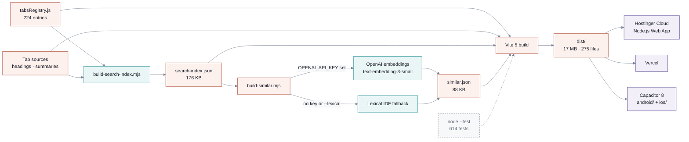
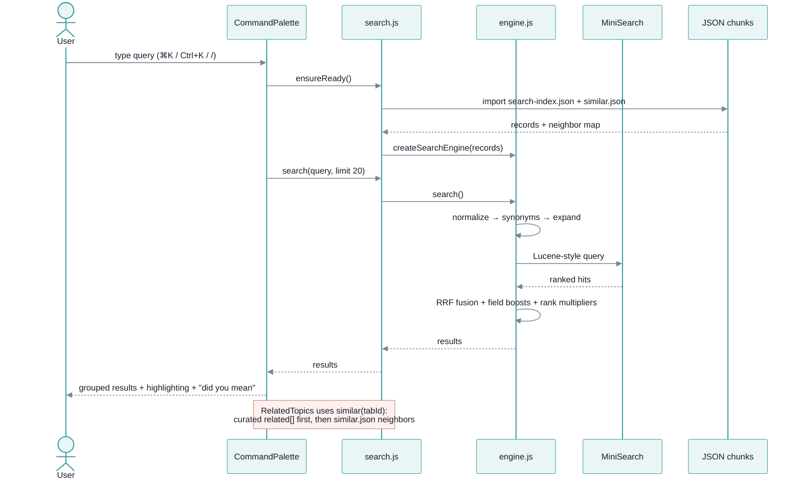
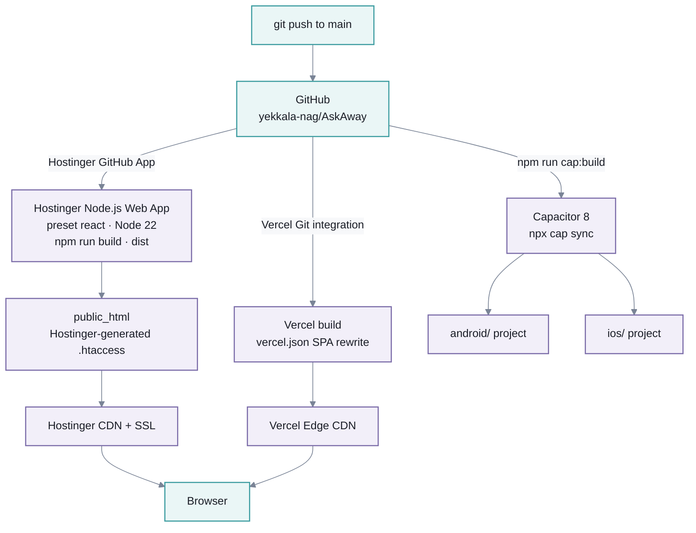

# AskAway — Architecture

Static-first React SPA for an interactive AI-engineering curriculum. No application
server, no database, no auth. All content ships as code and assets; progress lives in
the browser.

> Diagrams use Mermaid. They render on GitHub/GitLab, in VS Code with a Mermaid
> extension, or at <https://mermaid.live>.

## At a glance

| Dimension | Value |
| --- | --- |
| App type | Client-rendered SPA (no SSR, no backend) |
| Framework | React 18.3.1 + Vite 5.4.1 |
| Navigation | `?tab=<id>` query param + History API (no router library) |
| Content units | 224 registry entries: 201 topics + 23 hub pages |
| Code units | 187 `*Tab.jsx`, 132 `*Engine.js`, 443 files under `src/` |
| Search | MiniSearch 7.2.0 over a lazy-loaded JSON index |
| Persistence | `localStorage` / `sessionStorage` only |
| Build output | `dist/` ≈ 17 MB, 275 files |
| Tests | `node --test`, 45 suites / 614 tests |
| Runtime | Node.js ≥ 22 |
| Deploy | Hostinger Cloud (Node.js Web App), Vercel, Capacitor 8 |

---

## 1. System context

---

## 2. Frontend runtime architecture

### Shell and routing

- `src/main.jsx:6-12` mounts `AppNew` inside `React.StrictMode` and a top-level
  `ErrorBoundary`.
- `src/AppNew.jsx:312-383` reads `?tab=`, normalizes legacy ids, writes
  `history.pushState` on topic change, and restores state on `popstate`.
- Per-tab scroll positions are kept in a `useRef` map, not persisted.
- `src/AppNew.jsx:21-300` holds the `TabComponents` lazy map; registry entries are
  the fallback (`getTabById(tabId)?.component`).
- `src/AppContent.jsx` is a bridge that re-exports the legacy `src/App.jsx`
  (22,668 lines). Any tab loaded through this bridge pulls the full legacy chunk
  (`App-*.js`, 1.36 MB / 324 KB gzip).

### Content and registry

- `src/registry/tabsRegistry.js` — `CATEGORIES` (6), `UMBRELLA_TOPICS` (6),
  `TABS_REGISTRY` (224), plus `getUmbrellaForTab`, `getTabById`,
  `getTabsForUmbrella`.
- `src/registry/curriculum.js` — umbrella → child umbrella → topic hierarchy with
  levels (L1–L3) and prerequisites.
- `src/registry/` also holds `diagnostics.js`, `exitChecks*.js`, `antiPatterns.js`,
  `warStories.js` used by quizzes, gates, and progress.
- `src/hubPages/` — 23 hub landing pages, each a `*HubTab.jsx` plus shared
  `HubPage.jsx` / `HubContentPage.jsx` and `data/`.
- Topic modules pair a React component with a pure `*Engine.js` data/logic module,
  which is what the Node test suite exercises.

### UI and design system

- `src/design-system/` — `tokens.js`, `globalStyles.js`, `diagramTokens.js`,
  `spectrum.js`, `index.js`. Styling is token-driven inline/JS styles; there is no
  Tailwind or CSS framework.
- `src/components/` — `layout/` (primitives), `ui/` (nav, cards, code blocks,
  diagrams, quizzes, charts), `overview/`, `workbench/`, `ragPlayground/`,
  `search/`.
- `src/styles/legacyStyles.js` is still passed to legacy components as the `s`
  prop.

### Services and persistence

| Service | Role | Storage |
| --- | --- | --- |
| `mastery.js` | Visit/quiz/simulator evidence, mastery score ≥ 70 | `adaptive_mastery_v2`, `adaptive_completed_tabs` |
| `adaptiveLearning.js` | Tracks, placement, next/previous topic | `adaptive_current_track`, `adaptive_active_tab`, `adaptive_placement_v1` |
| `promptComposer.js` | Compose prompts from taxonomy + library | — |
| `qualityEvaluator.js` | Heuristic prompt quality scoring | — |
| `frameworkRecommender.js` / `frameworkLibrary.js` | Framework selection | — |
| `outputContract.js` | Output-contract validation | — |
| `refinementLab.js` | Refinement experiments | `askaway_refinement_lab_v1` |
| `promptLibrary.js` | User prompt library | `askaway_prompt_library_v1` |
| `workflowComposer.js` / `clarificationEngine.js` | Workflow and clarification logic | — |
| `StorageNoticeBanner.jsx` | Storage consent | `ai_rag_storage_consent` |

No data leaves the browser unless the user explicitly enters an OpenAI key in the
document-structure tooling.

---

## 3. Build and content pipeline

| Script | Purpose | Output |
| --- | --- | --- |
| `scripts/build-search-index.mjs` | Draft one search record per tab from the registry + component source; preserves hand-edits | `src/search/search-index.json` |
| `scripts/build-similar.mjs` | Embed title + summary + tags; top-5 neighbors per tab | `src/search/similar.json` |
| `scripts/restyle-legacy-svg.mjs` | Recolor legacy SVG assets | `public/assets/` |
| `npm run build` | Vite production build | `dist/` |
| `npm run cap:build` | Web build + `cap sync` | `android/`, `ios/` |

Embedding vectors are cached in `scripts/.embedding-cache.json` (gitignored) and
keyed by content hash, so reruns are deterministic and only changed tabs are
re-embedded. The API key comes only from `OPENAI_API_KEY`.

---

## 4. Search request flow

- Public API: `search`, `similar`, `suggest`, `filterTabIds`, `ensureReady`,
  `isReady`, `setSemanticEmbedder`, `getRecord` (`src/search/search.js:1-164`).
- Ranking: title 6 > tags/aliases 3 > summary 2 > body 1; prefix + fuzzy distance
  (1 for 4–5 chars, 2 for ≥ 6); synonym-expanded and plain rankings fused with
  reciprocal rank fusion (`src/search/engine.js:16-135`).
- Semantic search is opt-in: `VITE_SEMANTIC_SEARCH=1` plus a caller-supplied
  embedder; results merge via RRF.
- The index and neighbor map are dynamic imports, so they stay out of the entry
  bundle. On first palette open they load in parallel.

---

## 5. Deployment topology

| Target | Config | Notes |
| --- | --- | --- |
| Hostinger Cloud | `engines.node >= 22`, `.nvmrc`; hPanel: `react`, `npm run build`, `dist`, blank entry | Requires Business Web Hosting or Cloud Startup+; Hostinger regenerates `.htaccess` |
| Vercel | `vercel.json` — Vite framework, `dist`, catch-all rewrite | Hobby tier is non-commercial |
| Capacitor | `capacitor.config.json` — `webDir: "dist"` | Same build artifacts; Android/iOS shells |

The app uses `?tab=<id>` rather than path routing, so deep links work on any static
host without extra rewrite rules. Vercel still ships a catch-all for safety.

---

## 6. Technical stack

| Layer | Technology | Version | Evidence |
| --- | --- | --- | --- |
| UI runtime | React, React DOM | 18.3.1 | `package.json` |
| Build tool | Vite | 5.4.1 | `package.json`, `vite.config.js` |
| React plugin | `@vitejs/plugin-react` | 4.3.1 | `package.json` |
| Search | MiniSearch | 7.2.0 | `package.json`, `src/search/engine.js` |
| PDF parsing | `pdfjs-dist` | 6.2.108 | `src/documentStructure/pdfParser.js` |
| Mobile | Capacitor core / Android / iOS | 8.5.0 | `package.json`, `capacitor.config.json` |
| Mobile plugins | Keyboard / Splash / Status Bar | 8.0.5 / 8.0.2 / 8.0.3 | `package.json` |
| Runtime | Node.js | ≥ 22 | `package.json` engines, `.nvmrc` |
| Tests | Node built-in test runner | Node 22+ | `npm test`, `tests/` |
| Styling | Design tokens + JS style objects | in-repo | `src/design-system/` |
| Routing | URLSearchParams + History API | native | `src/AppNew.jsx` |
| State | React hooks + module-level services | native | `src/AppNew.jsx`, `src/services/` |
| Persistence | Web Storage | native | `src/services/*.js` |
| Hosting | Hostinger Cloud / Vercel | — | `README.md`, `vercel.json` |
| CI/CD | Hostinger GitHub App / Vercel Git | — | `README.md` |

### Bundle profile (production)

| Artifact | Size | Gzip | Notes |
| --- | --- | --- | --- |
| Entry `index-*.js` | 368.59 kB | 116.50 kB | Shell + TopBar + registry + lazy() refs (target ≤ 120 kB) |
| `react-*.js` | 141.83 kB | 45.41 kB | Split from entry via `manualChunks`, modulepreloaded in parallel |
| `vendor-*.js` | 496.25 kB | 147.67 kB | Split from entry (minisearch etc.), loaded on demand (search) |
| `Sidebar-*.js` | 15.49 kB | 4.61 kB | Lazy chrome (Suspense skeleton) |
| `CommandPalette-*.js` | 10.71 kB | 3.99 kB | Lazy chrome (Suspense fallback) |
| `ProgressTab-*.js` | 3.94 kB | 1.58 kB | First bridge tab migrated to a standalone module (lazy) |
| Legacy `App-*.js` | 1,358.43 kB | 324.54 kB | Loads only for remaining bridge-backed tabs; removed per-tab as they migrate |
| `search-index-*.js` | 132.66 kB | 41.50 kB | Lazy on first palette open |
| `tocReconstructor-*.js` | 490.26 kB | 146.67 kB | Moves to server in Phase 5 |
| `dist/` total | ≈ 17 MB | — | — |
| Static assets | 9.2 MB (59 SVG, 16 PNG) | — | ≤ 3 MB lazy-loaded (Phase 1 asset optimization pending) |

---

## 7. Architectural decisions and constraints

1. **Static-first.** No server runtime, database, or auth. This keeps hosting cheap
   and lets the same `dist/` serve web, Android, and iOS.
2. **Registry-driven content.** `tabsRegistry.js` is the single source of truth for
   navigation, hub grouping, search-index generation, and curriculum metadata.
3. **Pure engines next to UI.** Each topic's data/logic lives in `*Engine.js`, so
   614 tests can run under `node --test` without a DOM.
4. **Progressive loading.** Tabs are `React.lazy`; search JSON loads on first
   palette open; the semantic embedder is opt-in.
5. **URL as state.** `?tab=<id>` is the canonical deep link; legacy ids are folded
   into new tabs (`LEGACY_TAB_FOLD`) without breaking bookmarks.
6. **Local-only personalization.** Mastery, tracks, prompts, and consent stay in
   `localStorage`; there is no telemetry or account system.
7. **Legacy bridge is the main debt.** `AppContent.jsx` re-exports the 22.7k-line
   `App.jsx`, so any bridge-backed tab loads a 1.36 MB chunk. Migrating those tabs
   to standalone modules is the highest-leverage performance work.
8. **Client-side AI is optional and user-keyed.** `DocumentStructureTab` can call
   OpenAI directly; there is no server proxy, so keys are never stored by the app.
9. **Asset weight dominates hosting cost.** 9.2 MB of diagrams make CDN caching and
   unmetered egress the key hosting criteria (hence Cloudflare/Hostinger CDN).
10. **No router, no state library, no CSS framework.** Deliberate minimal
    dependency surface; the trade-off is manual URL/scroll handling.
11. **Lazy shell chrome.** `Sidebar` and `CommandPalette` are split out of the entry
    bundle via `React.lazy` (Suspense skeletons) and `react`/`vendor` are split via
    Vite `manualChunks`. Entry reduced 200.89 kB → 116.48 kB gzip. Hashed assets are
    served `Cache-Control: public, max-age=31536000, immutable` via `vercel.json`.

## 8. Client/server split (Phase 2 — Supabase foundation)

AskAway remains a static-first React SPA; a server boundary is added only for what
must be dynamic: auth, progress sync, AI proxy, and PDF/TOC parsing.

### 8.1 Runtime boundary

| Concern | Client (static SPA) | Server (Vercel functions / Supabase) |
|---------|---------------------|--------------------------------------|
| UI + routing | React 18 + Vite, `?tab=<id>` deep links | — |
| Auth UI | `AuthButton` (lazy-loaded via `React.lazy`) | Supabase Auth (magic link + OAuth) |
| Auth keys | `VITE_SUPABASE_URL`, `VITE_SUPABASE_ANON_KEY` only | `SUPABASE_SERVICE_ROLE_KEY` (server-only, never in client) |
| OpenAI key | User-supplied at runtime, never stored | `OPENAI_API_KEY` (server-only) |
| Progress | `localStorage` (source of truth offline) | `user_progress`, `user_profiles`, `user_prompts` (RLS-protected) |
| AI calls | Proxied through `/api/ai/*` (server) | OpenAI called server-side, JWT-protected, rate-limited |
| PDF/TOC | — | `/api/document/parse` (Node runtime, pdf.js) |
| Search | Static JSON index (build-time) | optional `/api/search` (cached) |

### 8.2 Auth model

- Anonymous use is unchanged and fully functional (`localStorage` only).
- Login is optional and only unlocks cross-device sync.
- Sign-in methods: magic link (email OTP) + one OAuth provider (Google).
- `supabaseClient.js` exposes only the anon key to the client; the service-role key
  and `OPENAI_API_KEY` are server-only (`api/_lib/supabaseAdmin.js`).

### 8.3 Data model (Supabase)

| Table | RLS | Purpose |
|-------|-----|---------|
| `profiles` | owner-only | user display name |
| `user_progress` | owner-only | mastery, completed tabs, track, active tab |
| `user_prompts` | owner-only | user prompt library (unioned with local by `client_id`) |
| `ai_usage` | read-own (write via service role) | per-user per-day token/request budget |

Every table has RLS enabled; `user_prompts` is indexed on `(user_id, updated_at)`.
No table is created without policies. Cross-user reads are verified by
`supabase/migrations/002_rls_cross_user_check.sql` (must return 0 rows).

### 8.4 API route conventions (Vercel functions)

- Every API route sets explicit `Cache-Control`; uncached routes carry a justification comment.
- Routes under `/api/` use the Node runtime and `getSupabaseAdmin()` for server-side writes.
- CORS is restricted to the production domain and Capacitor origins.
- No secrets, tokens, or user prompts are logged to console or server logs.

### 8.5 Testing

- `tests/supabaseAuth.test.js` covers magic-link, sign-out, session, and auth-state
  change using dependency injection (no network, no ESM module mocking).
- RLS cross-user isolation is proved by `supabase/migrations/002_rls_cross_user_check.sql`.

### 8.6 Progress sync (local-first, Phase 3)

- `src/services/sync.js` — localStorage is the source of truth while offline. On
  login, `initSync` pulls the server row, merges with local, persists, then pushes.
  Server writes are debounced (≥ 5s) via `markDirty`/`flush` and batched into one
  request. An offline queue retries failed pushes with exponential backoff.
- `main.jsx` calls `enableAutoDirty()` — wraps `localStorage.setItem` for sync-relevant
  keys (`adaptive_mastery_v2`, `adaptive_completed_tabs`, `adaptive_current_track`,
  `adaptive_active_tab`, `adaptive_placement_v1`, `askaway_prompt_library_v1`,
  `ai_rag_storage_consent`) so any service write triggers a debounced sync.
- Consent gate: no server sync without `ai_rag_storage_consent === 'acknowledged'`.
- `SyncDot` in TopBar shows `synced` / `syncing` / `offline` / `error`; hidden until
  the user consents.
- `AuthButton` calls `initSync(userId, supabase)` on sign-in.
- Merge rules (pure, unit-tested in `tests/sync.test.js`):
  - mastery score = max per tab (tie → later `updatedAt`, else local)
  - completed tabs = union (deduped)
  - prompt library = union by `client_id`, latest `updated_at` wins
  - track / active tab / placement = latest timestamp wins

### 8.7 AI proxy (`/api/ai/*`, Phase 4)

- `api/ai/chat.js` — Vercel serverless function (Node runtime, maxDuration 60s)
  proxying OpenAI Chat Completions. Streams the response (SSE) to the client.
  Configured in `vercel.json` under `functions`.
- Auth model:
  - Platform-key path (`OPENAI_API_KEY`, server-only): requires a valid Supabase
    JWT in the `Authorization` header. JWT is decoded (`sub` extracted) for
    per-user rate limiting; data access stays protected by RLS.
  - User-supplied key path (`x-openai-api-key` header): no auth required,
    per-IP rate limit only. The key is forwarded to OpenAI but never stored
    server-side.
- Protection:
  - Input validation: `messages` required (non-empty array), model allow-listed
    (`gpt-4o`, `gpt-4o-mini`, `gpt-3.5-turbo`), payload capped at 256 KB,
    `max_tokens` capped at 4096.
  - Rate limits: per-user daily budget (50 requests / 50K tokens per day via
    `ai_usage` table) + per-IP rate limit (20 requests/minute, in-memory best
    effort).
  - Returns `429` with a clear message when over quota.
- Client side: `src/lib/aiProxy.js` calls `/api/ai/chat`, supports SSE
  streaming via `onToken`, forwards user-supplied key via `x-openai-api-key`.
- `DocumentStructureTab` `callLLM` and `contentGenerators` `fetchAI` now call
  the proxy instead of fetching OpenAI directly. Verified: no
  `api.openai.com`, `Authorization` Bearer, or `OPENAI_API_KEY` in the
  `DocumentStructureTab` client bundle.
- `vercel.json` sets `Cache-Control: no-store` and CORS headers for `/api/*`
  (uncached: dynamic AI proxy; caching LLM outputs would return stale results).

### 8.8 Document parse API (`/api/document/parse`, Phase 5)

- `api/document/parse.js` — Vercel serverless function (Node runtime, maxDuration 60s)
  that accepts a raw PDF (`application/octet-stream`) and returns structured
  `{ line_df, span_df }` JSON using `pdfjs-dist/legacy/build/pdf.mjs`
  (the Node-compatible legacy build; no worker thread required).
- No auth required — the PDF is processed in-function and never stored.
- Per-IP rate limit (20 req/min) via the shared in-memory store in
  `api/_lib/rateLimit.js` (keyed separately from the AI proxy).
- Input validation: max 20 MB, `%PDF-` magic bytes check, 100-page cap.
- `Cache-Control: no-store` — the result is document-specific and must not be cached.
- Client side: `DocumentStructureTab.parsePdfViaProxy(file)` POSTs the file to
  `/api/document/parse`. The client no longer imports `pdfjs-dist` for parsing.
- `src/documentStructure/lineDfUtils.js` — pure helpers (`enrichLineDfWithStyle`,
  `weightedAverageFontSize`, `computeBoldRatio`, `mostCommonFont`) extracted from
  `pdfParser.js` so they have no pdfjs dependency. Used by client code,
  `tocReconstructor.js`, and `agenticParsing/methodAdapters.js`.
- Verified: `grep dist/` confirms the `DocumentStructureTab` chunk contains no
  `getDocument` or `parsePdf` references; only `parsePdfViaProxy` + `octet-stream`.
- `PdfOverlayViewer.jsx` retains `pdfjs-dist` for browser-side canvas rendering
  (legitimate client use — cannot server-render a PDF canvas).

### 8.9 CI/CD & edge caching (Phase 6)

- `.github/workflows/ci.yml` — GitHub Actions workflow running on every push/PR:
  - `test` job: `npm test` on Node 22 (646 tests, 49 suites).
  - `build` job: `npm run build` (Vite production build); uploads `dist/` artifact.
  - Optional `deploy-preview` / `deploy-production` jobs (commented out) for Vercel
    deployments via `amondnet/vercel-action` — enable by adding
    `VERCEL_TOKEN`, `VERCEL_ORG_ID`, `VERCEL_PROJECT_ID` as repository secrets.
- `vercel.json` security headers applied to all responses:
  - `X-Content-Type-Options: nosniff`
  - `X-Frame-Options: DENY`
  - `Referrer-Policy: strict-origin-when-cross-origin`
- Cache strategy (unchanged from Phase 1/4/5, documented here for completeness):
  - `/assets/*` (hashed filenames) → `public, max-age=31536000, immutable` (1 year).
  - `/api/*` (dynamic serverless functions) → `Cache-Control: no-store`.
  - SPA fallback (`index.html`) → no cache header (served fresh on each deploy).
- README extended with Vercel deployment guide:
  - Quick start (CLI), GitHub integration, environment variable hygiene,
    Hobby tier limits (function duration, payload size, bandwidth, invocations).
- Bridge tab migration strategy (Phase 7 target):
  - 43 tabs still routed through `AppContent.jsx` → loads 324 kB gzip `App-*.js` chunk.
  - Priority order (from `docs/legacy-migration.md`): `overview`, `glossary`, `archconcepts`,
    `workflows`, `unhobbling`, `promptmgmt`, `rag`, `pipeline`, `filtering`, `hierrag`,
    `qparseloop`, `prodrag`, `genpatterns`, `fourpdfs`, `hallucbricks`, etc.
  - Each migrated tab removes one load of the legacy bridge chunk.

### 8.10 Asset optimization (Phase 7)

- `scripts/optimize-assets.mjs` — build-time asset optimizer (runs via `node scripts/optimize-assets.mjs`):
  - PNG → WebP (quality 85, `sharp`) + optimized PNG (palette + zlib compression). 16 PNGs:
    4.8 MB → 1.3 MB WebP (73% avg reduction, largest 96% saved).
  - SVG → SVGO multipass with safe presets. 61 SVGs: ~8% avg reduction (some 17-24%).
  - Outputs to `public/assets/optimized/` with `manifest.json` mapping originals → optimized paths.
  - Add `npm run optimize-assets` to the build pipeline or run manually after adding assets.
- `DiagramImage.jsx` updated to use `<picture>` with WebP source + PNG fallback for raster images
  (`.png`, `.jpg`, `.webp`); SVGs use the optimized version directly. Manifest-driven path resolution
  with graceful fallback to the original `src` if the manifest is missing or the entry is not found.
  - Thumbnail: WebP → PNG fallback. Fullscreen lightbox: PNG (lossless for zoom).
  - `loading="lazy"` + `decoding="async"` already present (unchanged).
- `vercel.json`: `/assets/optimized/*` served with `Cache-Control: public, max-age=31536000, immutable`.
- Build output: `dist/assets/optimized/` contains all WebP/PNG/SVG files + `manifest.json`.
- Dev deps added: `sharp` (image processing), `svgo` (SVG optimization) — dev-only, not bundled.
- Bridge tab migration deferred: 43 tabs remain on `AppContent.jsx` (324 kB gzip). Each tab requires
  extracting inline dependencies from the 22k-line `App.jsx`; tracked in `docs/legacy-migration.md`.

