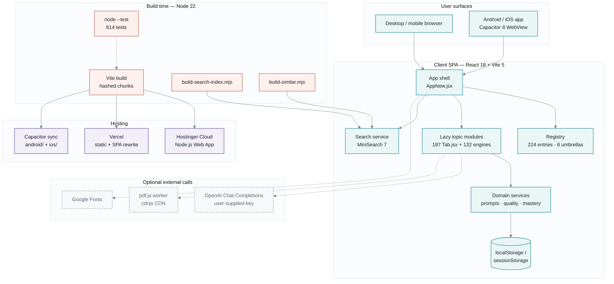
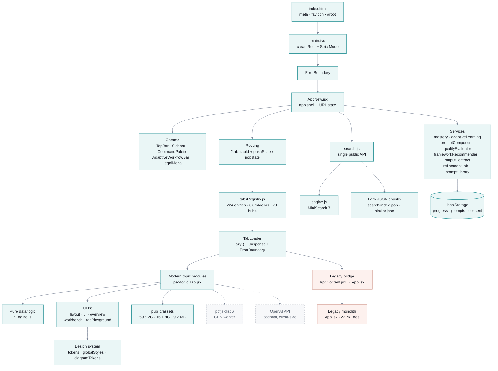
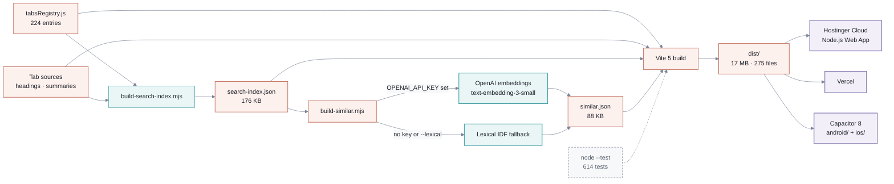
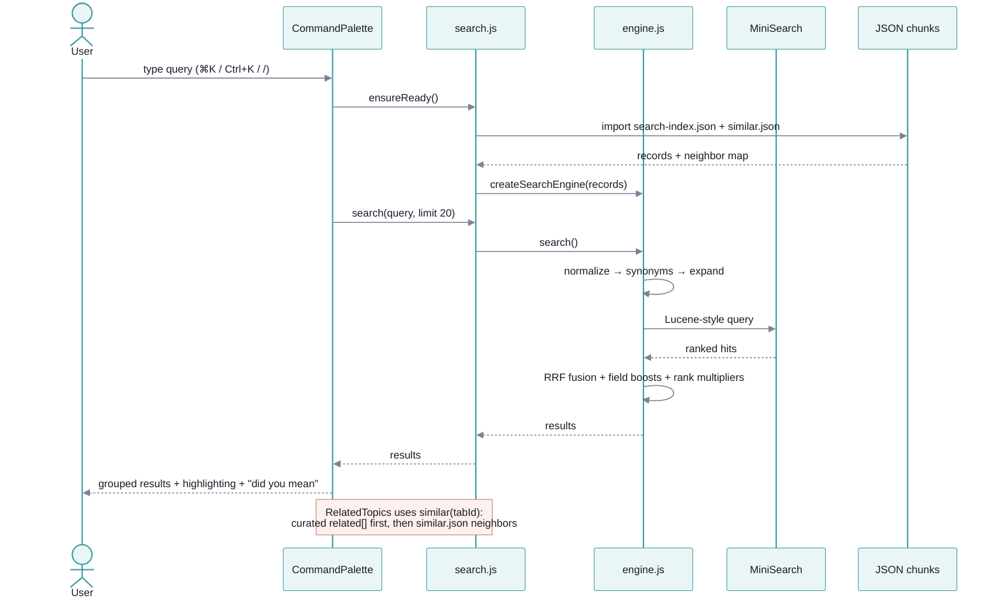
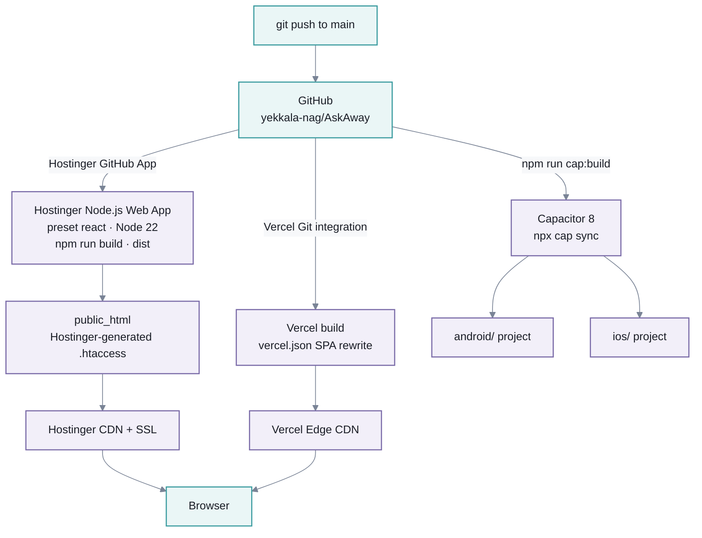

# AskAway — Architecture

Static-first React SPA for an interactive AI-engineering curriculum. No application
server, no database, no auth. All content ships as code and assets; progress lives in
the browser.

> Diagrams use Mermaid. They render on GitHub/GitLab, in VS Code with a Mermaid
> extension, or at <https://mermaid.live>.

## At a glance

| Dimension | Value |
| --- | --- |
| App type | Client-rendered SPA (no SSR, no backend) |
| Framework | React 18.3.1 + Vite 5.4.1 |
| Navigation | `?tab=<id>` query param + History API (no router library) |
| Content units | 224 registry entries: 201 topics + 23 hub pages |
| Code units | 187 `*Tab.jsx`, 132 `*Engine.js`, 443 files under `src/` |
| Search | MiniSearch 7.2.0 over a lazy-loaded JSON index |
| Persistence | `localStorage` / `sessionStorage` only |
| Build output | `dist/` ≈ 17 MB, 275 files |
| Tests | `node --test`, 45 suites / 614 tests |
| Runtime | Node.js ≥ 22 |
| Deploy | Hostinger Cloud (Node.js Web App), Vercel, Capacitor 8 |

---

## 1. System context

---

## 2. Frontend runtime architecture

### Shell and routing

- `src/main.jsx:6-12` mounts `AppNew` inside `React.StrictMode` and a top-level
  `ErrorBoundary`.
- `src/AppNew.jsx:312-383` reads `?tab=`, normalizes legacy ids, writes
  `history.pushState` on topic change, and restores state on `popstate`.
- Per-tab scroll positions are kept in a `useRef` map, not persisted.
- `src/AppNew.jsx:21-300` holds the `TabComponents` lazy map; registry entries are
  the fallback (`getTabById(tabId)?.component`).
- `src/AppContent.jsx` is a bridge that re-exports the legacy `src/App.jsx`
  (22,668 lines). Any tab loaded through this bridge pulls the full legacy chunk
  (`App-*.js`, 1.36 MB / 324 KB gzip).

### Content and registry

- `src/registry/tabsRegistry.js` — `CATEGORIES` (6), `UMBRELLA_TOPICS` (6),
  `TABS_REGISTRY` (224), plus `getUmbrellaForTab`, `getTabById`,
  `getTabsForUmbrella`.
- `src/registry/curriculum.js` — umbrella → child umbrella → topic hierarchy with
  levels (L1–L3) and prerequisites.
- `src/registry/` also holds `diagnostics.js`, `exitChecks*.js`, `antiPatterns.js`,
  `warStories.js` used by quizzes, gates, and progress.
- `src/hubPages/` — 23 hub landing pages, each a `*HubTab.jsx` plus shared
  `HubPage.jsx` / `HubContentPage.jsx` and `data/`.
- Topic modules pair a React component with a pure `*Engine.js` data/logic module,
  which is what the Node test suite exercises.

### UI and design system

- `src/design-system/` — `tokens.js`, `globalStyles.js`, `diagramTokens.js`,
  `spectrum.js`, `index.js`. Styling is token-driven inline/JS styles; there is no
  Tailwind or CSS framework.
- `src/components/` — `layout/` (primitives), `ui/` (nav, cards, code blocks,
  diagrams, quizzes, charts), `overview/`, `workbench/`, `ragPlayground/`,
  `search/`.
- `src/styles/legacyStyles.js` is still passed to legacy components as the `s`
  prop.

### Services and persistence

| Service | Role | Storage |
| --- | --- | --- |
| `mastery.js` | Visit/quiz/simulator evidence, mastery score ≥ 70 | `adaptive_mastery_v2`, `adaptive_completed_tabs` |
| `adaptiveLearning.js` | Tracks, placement, next/previous topic | `adaptive_current_track`, `adaptive_active_tab`, `adaptive_placement_v1` |
| `promptComposer.js` | Compose prompts from taxonomy + library | — |
| `qualityEvaluator.js` | Heuristic prompt quality scoring | — |
| `frameworkRecommender.js` / `frameworkLibrary.js` | Framework selection | — |
| `outputContract.js` | Output-contract validation | — |
| `refinementLab.js` | Refinement experiments | `askaway_refinement_lab_v1` |
| `promptLibrary.js` | User prompt library | `askaway_prompt_library_v1` |
| `workflowComposer.js` / `clarificationEngine.js` | Workflow and clarification logic | — |
| `StorageNoticeBanner.jsx` | Storage consent | `ai_rag_storage_consent` |

No data leaves the browser unless the user explicitly enters an OpenAI key in the
document-structure tooling.

---

## 3. Build and content pipeline

| Script | Purpose | Output |
| --- | --- | --- |
| `scripts/build-search-index.mjs` | Draft one search record per tab from the registry + component source; preserves hand-edits | `src/search/search-index.json` |
| `scripts/build-similar.mjs` | Embed title + summary + tags; top-5 neighbors per tab | `src/search/similar.json` |
| `scripts/restyle-legacy-svg.mjs` | Recolor legacy SVG assets | `public/assets/` |
| `npm run build` | Vite production build | `dist/` |
| `npm run cap:build` | Web build + `cap sync` | `android/`, `ios/` |

Embedding vectors are cached in `scripts/.embedding-cache.json` (gitignored) and
keyed by content hash, so reruns are deterministic and only changed tabs are
re-embedded. The API key comes only from `OPENAI_API_KEY`.

---

## 4. Search request flow

- Public API: `search`, `similar`, `suggest`, `filterTabIds`, `ensureReady`,
  `isReady`, `setSemanticEmbedder`, `getRecord` (`src/search/search.js:1-164`).
- Ranking: title 6 > tags/aliases 3 > summary 2 > body 1; prefix + fuzzy distance
  (1 for 4–5 chars, 2 for ≥ 6); synonym-expanded and plain rankings fused with
  reciprocal rank fusion (`src/search/engine.js:16-135`).
- Semantic search is opt-in: `VITE_SEMANTIC_SEARCH=1` plus a caller-supplied
  embedder; results merge via RRF.
- The index and neighbor map are dynamic imports, so they stay out of the entry
  bundle. On first palette open they load in parallel.

---

## 5. Deployment topology

| Target | Config | Notes |
| --- | --- | --- |
| Hostinger Cloud | `engines.node >= 22`, `.nvmrc`; hPanel: `react`, `npm run build`, `dist`, blank entry | Requires Business Web Hosting or Cloud Startup+; Hostinger regenerates `.htaccess` |
| Vercel | `vercel.json` — Vite framework, `dist`, catch-all rewrite | Hobby tier is non-commercial |
| Capacitor | `capacitor.config.json` — `webDir: "dist"` | Same build artifacts; Android/iOS shells |

The app uses `?tab=<id>` rather than path routing, so deep links work on any static
host without extra rewrite rules. Vercel still ships a catch-all for safety.

---

## 6. Technical stack

| Layer | Technology | Version | Evidence |
| --- | --- | --- | --- |
| UI runtime | React, React DOM | 18.3.1 | `package.json` |
| Build tool | Vite | 5.4.1 | `package.json`, `vite.config.js` |
| React plugin | `@vitejs/plugin-react` | 4.3.1 | `package.json` |
| Search | MiniSearch | 7.2.0 | `package.json`, `src/search/engine.js` |
| PDF parsing | `pdfjs-dist` | 6.2.108 | `src/documentStructure/pdfParser.js` |
| Mobile | Capacitor core / Android / iOS | 8.5.0 | `package.json`, `capacitor.config.json` |
| Mobile plugins | Keyboard / Splash / Status Bar | 8.0.5 / 8.0.2 / 8.0.3 | `package.json` |
| Runtime | Node.js | ≥ 22 | `package.json` engines, `.nvmrc` |
| Tests | Node built-in test runner | Node 22+ | `npm test`, `tests/` |
| Styling | Design tokens + JS style objects | in-repo | `src/design-system/` |
| Routing | URLSearchParams + History API | native | `src/AppNew.jsx` |
| State | React hooks + module-level services | native | `src/AppNew.jsx`, `src/services/` |
| Persistence | Web Storage | native | `src/services/*.js` |
| Hosting | Hostinger Cloud / Vercel | — | `README.md`, `vercel.json` |
| CI/CD | Hostinger GitHub App / Vercel Git | — | `README.md` |

### Bundle profile (production)

| Artifact | Size | Gzip |
| --- | --- | --- |
| Entry `index-*.js` | 627.53 kB | 200.89 kB |
| Legacy `App-*.js` | 1,358.31 kB | 324.49 kB |
| `search-index-*.js` | 132.66 kB | 41.50 kB |
| `tocReconstructor-*.js` | 490.26 kB | 146.67 kB |
| `dist/` total | ≈ 17 MB | — |
| Static assets | 9.2 MB (59 SVG, 16 PNG) | — |

---

## 7. Architectural decisions and constraints

1. **Static-first.** No server runtime, database, or auth. This keeps hosting cheap
   and lets the same `dist/` serve web, Android, and iOS.
2. **Registry-driven content.** `tabsRegistry.js` is the single source of truth for
   navigation, hub grouping, search-index generation, and curriculum metadata.
3. **Pure engines next to UI.** Each topic's data/logic lives in `*Engine.js`, so
   614 tests can run under `node --test` without a DOM.
4. **Progressive loading.** Tabs are `React.lazy`; search JSON loads on first
   palette open; the semantic embedder is opt-in.
5. **URL as state.** `?tab=<id>` is the canonical deep link; legacy ids are folded
   into new tabs (`LEGACY_TAB_FOLD`) without breaking bookmarks.
6. **Local-only personalization.** Mastery, tracks, prompts, and consent stay in
   `localStorage`; there is no telemetry or account system.
7. **Legacy bridge is the main debt.** `AppContent.jsx` re-exports the 22.7k-line
   `App.jsx`, so any bridge-backed tab loads a 1.36 MB chunk. Migrating those tabs
   to standalone modules is the highest-leverage performance work.
8. **Client-side AI is optional and user-keyed.** `DocumentStructureTab` can call
   OpenAI directly; there is no server proxy, so keys are never stored by the app.
9. **Asset weight dominates hosting cost.** 9.2 MB of diagrams make CDN caching and
   unmetered egress the key hosting criteria (hence Cloudflare/Hostinger CDN).
10. **No router, no state library, no CSS framework.** Deliberate minimal
    dependency surface; the trade-off is manual URL/scroll handling.
