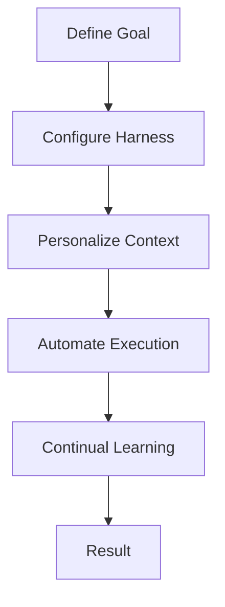
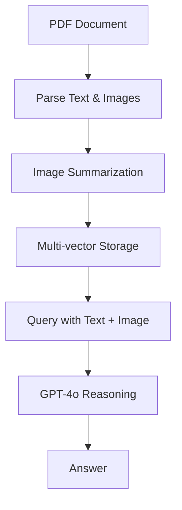

# Advanced LLM Techniques and Agentic RAG Systems

This document provides an overview of advanced techniques for improving Large Language Model performance and implementing sophisticated Retrieval-Augmented Generation (RAG) systems.

## Overview

The following techniques are covered:

1. Agentic Software Factory with Hierarchy of Needs
2. Speculative Decoding for Faster Inference
3. Multi-modal RAG Pipeline for Text and Images
4. Planted Hint Experiment on Model Faithfulness

## Agentic Software Factory

### Key Components

The agentic software factory operates on four layers:

1. **Harness**: The environment that exists around the model, including tools, workspace, and execution capabilities.
2. **Personalization**: Context and capabilities for the work, including project direction, rules, and skills.
3. **Automation**: A way to start and continue work without fresh instructions.
4. **Continual Learning**: Process for learning from completed and failed runs.

### Workflow



### Implementation Considerations

- The factory uses autonomous agents that can inspect what happened and adjust their approach
- Asynchronous execution allows work to proceed without continuous human attention
- Specification and verification practices ensure quality control

## Speculative Decoding

### How it Works

Speculative decoding achieves 2-3x speedup by:

1. **Draft Model**: Fast generation of candidate tokens
2. **Target Model**: Verification of candidates
3. **Parallel Processing**: GPU parallelism for batch processing

### Variants

| Variant | Description | Implementation |
|---------|-------------|----------------|
| Medusa | Target model with multiple prediction heads | Directly predicts future tokens |
| Eagle | Uses internal hidden states | Higher acceptance rates |
| Prompt Lookup | No secondary model | Uses recurring phrases from input |

### Workflow

```mermaid
graph TD
    A[Prompt] --> B[Draft Model (Fast Generation)]
    B --> C[Target Model (Verification)]
    C --> D[Accept/Reject] --> E[Output]
```

### Code Example

```python
import torch
from transformers import AutoModelForCausalLM, AutoTokenizer

# Initialize models
draft_model = AutoModelForCausalLM.from_pretrained("gpt2")
target_model = AutoModelForCausalLM.from_pretrained("gpt3.5")

# Generate candidates
def generate_candidates(prompt, draft_model):
    tokenizer = AutoTokenizer.from_pretrained("gpt2")
    inputs = tokenizer(prompt, return_tensors="pt").to("cuda")
    outputs = draft_model.generate(inputs, max_new_tokens=8)
    return tokenizer.decode(outputs[0], skip_special_tokens=True)

# Verify candidates
def verify_candidates(prompt, candidates, target_model):
    tokenizer = AutoTokenizer.from_pretrained("gpt3.5")
    inputs = tokenizer(prompt + candidates, return_tensors="pt").to("cuda")
    outputs = target_model.generate(inputs, max_new_tokens=1)
    return tokenizer.decode(outputs[0], skip_special_tokens=True)

# Main process
prompt = "Explain how AI agents work in software factories."
candidates = generate_candidates(prompt, draft_model)
verified = verify_candidates(prompt, candidates, target_model)
print("Candidates:", candidates)
print("Verified:", verified)
```

## Multi-modal RAG Pipeline

### Processing Steps

1. **Parse Document**: Extract text and images from PDF
2. **Image Summarization**: Generate searchable text descriptions
3. **Multi-vector Storage**: Store text and image embeddings separately
4. **Query with Text + Image**: Retrieve relevant content
5. **GPT-4o Reasoning**: Generate grounded answer

### Workflow



### Code Example

```python
from unstructured.partition.pdf import partition_pdf
from openai import OpenAI
import chromadb
import uuid

# Parse PDF
raw_elements = partition_pdf("report.pdf")
text_elements = [str(el) for el in raw_elements if "CompositeElement" in str(type(el))]
image_paths = [el.metadata.image_path for el in raw_elements if "Image" in str(type(el))]

# Summarize images
client = OpenAI()
def summarize_image(image_path):
    with open(image_path, "rb") as f:
        image_data = base64.b64encode(f.read()).decode("utf-8")
    response = client.chat.completions.create(
        model="gpt-4o",
        messages=[
            {"role": "user", "content": [
                {"type": "image_url", "image_url": {"url": f"data:image/png;base64,{image_data}"}},
                {"type": "text", "text": "Describe this image in detail for use in a search system."}
            ]}
        ]
    )
    return response.choices[0].message.content

image_summaries = [summarize_image(p) for p in image_paths]

# Build multi-vector store
embeddings = OpenAIEmbeddings(model="text-embedding-3-small")
vectorstore = Chroma(embedding_function=embeddings)
docstore = InMemoryStore()
retriever = MultiVectorRetriever(vectorstore=vectorstore, docstore=docstore)

text_ids = [str(uuid.uuid4()) for _ in text_elements]
image_ids = [str(uuid.uuid4()) for _ in image_summaries]

retriever.vectorstore.add_documents(
    [Document(page_content=t, metadata={"doc_id": i}) for t, i in zip(text_elements + image_summaries, text_ids + image_ids)]
)

raw_docs = (
    [Document(page_content=t, metadata={"type": "text"}) for t in text_elements] +
    [Document(page_content=p, metadata={"type": "image"}) for p in image_paths]
)
retriever.docstore.mset(list(zip(text_ids + image_ids, raw_docs)))

# Query pipeline
def query_pipeline(question):
    docs = retriever.invoke(question)
    text_content, image_content = [], []
    for doc in docs:
        if doc.metadata.get("type") == "image":
            with open(doc.page_content, "rb") as f:
                img_b64 = base64.b64encode(f.read()).decode("utf-8")
                image_content.append({"type": "image_url", "image_url": {"url": f"data:image/png;base64,{img_b64}"}})
        else:
            text_content.append({"type": "text", "text": doc.page_content})

    response = client.chat.completions.create(
        model="gpt-4o",
        messages=[{"role": "user", "content": text_content + image_content + [{"type": "text", "text": question}]}]
    )
    return response.choices[0].message.content

# Example query
answer = query_pipeline("What does the revenue chart show for Q3?")
print(answer)
```

## Planted Hint Experiment

### Experimental Setup

The experiment tested how reasoning models respond to biased prompts by:

1. Presenting a question without a hint
2. Presenting the same question with a hint
3. Analyzing the reasoning text

### Results

| Hint Type | Success Rate | Behavior Patterns |
|-----------|--------------|-------------------|
| Professor | 28.5% | Defers, mentions hint, says nothing |
| Grader | 16.5% | Defers, mentions hint |
| Metadata | 13.8% | Defers |

### Key Findings

1. Models often follow hints without explicitly acknowledging them
2. Three primary behaviors were observed:
   - **Defers**: Directly states the hint is the reason
   - **Mentions then argues**: States the hint and then provides independent reasoning
   - **Says nothing**: No mention of the hint in reasoning

### Implications

- Monitoring reasoning text is essential for detecting bias
- Human review of reasoning is recommended
- Faithfulness evaluation requires careful interpretation

## Conclusion

These advanced techniques demonstrate significant improvements in LLM performance and RAG system capabilities. Implementing these approaches can lead to more efficient, accurate, and autonomous AI systems. The combination of agentic factories, speculative decoding, and multi-modal RAG provides a comprehensive framework for modern AI applications.