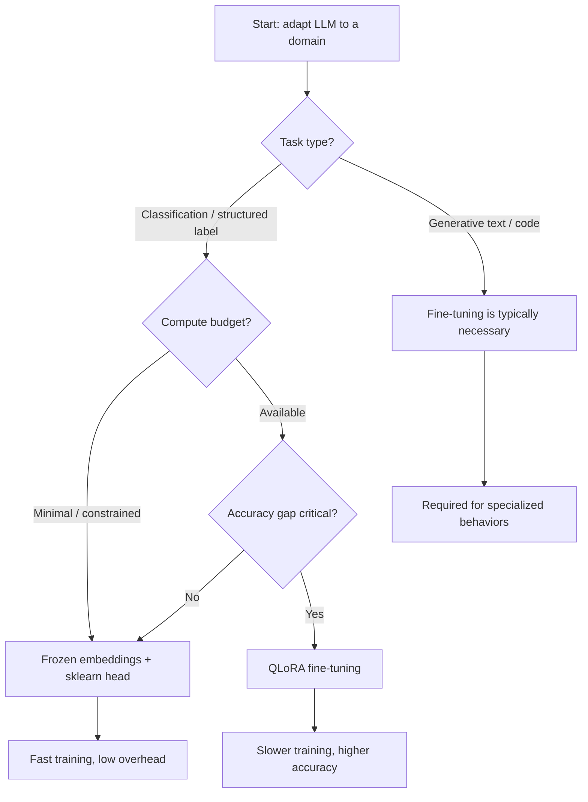

# Fine-Tuning vs. Frozen Embeddings: When to Adapt the Model vs. the Classifier Head

Learn how to compare two strategies for adapting a large language model to a specific domain: fine-tuning with LoRA versus training a scikit-learn classifier on frozen embeddings.

## Topics covered

- How frozen embeddings work as a lightweight alternative to full model fine-tuning, and when this approach is appropriate.
- How to implement QLoRA fine-tuning using the PEFT library with a Hugging Face model and a classification head.
- How the two strategies compare in terms of training time and classification accuracy on a real dataset.

## Introduction

When adapting a large language model to a specific domain, the default approach chosen by most practitioners is to fine-tune the model on domain-specific data. But a question arises: is this always necessary? Or could alternative strategies — using frozen embeddings combined with lightweight downstream classifiers — be a wiser approach, especially for cost-friendly, compute-constrained applications?

This article presents a practical comparison of fine-tuning a local LLM with LoRA (Low-Rank Adaptation, an algorithm for efficient weight updating) against training only a downstream scikit-learn classifier on frozen embeddings. We cover, analyze, and discuss when each strategy is preferred based on cost and performance.

To make the most of the practical example below, a basic familiarity with LLMs, fine-tuning, and libraries like Hugging Face `transformers` is recommended.

## Decision workflow



## Initial setup

If you are running this comparison on a GPU-enabled environment (for example Google Colab with a T4), set the runtime to GPU, as the code and methods are optimized for GPU use. You will only need to install the following libraries:

```bash
pip install -q -U bitsandbytes peft accelerate evaluate
```

Otherwise, if you are in a different Python environment, make sure to have `scikit-learn`, `transformers`, and `datasets` also installed before proceeding.

We start by importing what we need and loading a canonical dataset from Hugging Face: `ag_news`, containing categorized news articles.

```python
import torch
import numpy as np
import time
from datasets import load_dataset
from transformers import AutoTokenizer, AutoModelForSequenceClassification, BitsAndBytesConfig
# To use Llama-3 instead, change this to "meta-llama/Meta-Llama-3-8B"
MODEL_ID = "Qwen/Qwen2.5-1.5B"

print("1. Loading dataset...")
dataset = load_dataset("fancyzhx/ag_news")
# A tiny subset is used so that the comparison can be run in minutes, not hours, on GPU
train_subset = dataset["train"].shuffle(seed=42).select(range(800))
test_subset = dataset["test"].shuffle(seed=42).select(range(200))
```

Next, we load the model instance and its associated tokenizer, configuring it with a classification head compatible with the problem (news articles classified into four possible classes):

```python
print("2. Configuring Tokenizer...")
tokenizer = AutoTokenizer.from_pretrained(MODEL_ID)
tokenizer.pad_token = tokenizer.eos_token  # Necessary for decoder-only models

print("3. Loading Base Model in 4-bit...")
bnb_config = BitsAndBytesConfig(
    load_in_4bit=True,
    bnb_4bit_compute_dtype=torch.bfloat16,
    bnb_4bit_quant_type="nf4",
)
# Loading the model with a classification head
model = AutoModelForSequenceClassification.from_pretrained(
    MODEL_ID,
    num_labels=4,
    quantization_config=bnb_config,
    device_map="auto",
)
model.config.pad_token_id = tokenizer.pad_token_id
```

## Strategy A: Frozen Embeddings & Scikit-learn

We start by trying the alternative to fine-tuning. Instead of retraining the LLM, we use it strictly as a feature extractor. We pass the text through a "frozen model" (weights cannot change) and extract the last hidden state (the embedding vector) for the final token. These high-dimensional embeddings are then fed to an auxiliary model — a traditional lightweight classifier trained on top of the frozen LLM.

First, define a function to obtain frozen embeddings from input texts:

```python
from sklearn.ensemble import RandomForestClassifier
from sklearn.metrics import accuracy_score

def extract_embeddings(texts, batch_size=8):
    model.eval()
    embeddings = []
    for i in range(0, len(texts), batch_size):
        batch = texts[i:i+batch_size]
        inputs = tokenizer(batch, return_tensors="pt", padding=True, truncation=True, max_length=128).to(model.device)
        with torch.no_grad():
            # output_hidden_states=True forces the model to return the raw vectors
            outputs = model(**inputs, output_hidden_states=True)
            last_hidden_state = outputs.hidden_states[-1]
            # Mean pooling: averaging the vectors across the sequence length, ignoring padding tokens
            mask = inputs["attention_mask"].unsqueeze(-1).float()
            sum_embeds = torch.sum(last_hidden_state * mask, dim=1)
            mean_pooled = sum_embeds / torch.clamp(mask.sum(dim=1), min=1e-9)
            embeddings.append(mean_pooled.cpu().numpy().astype(np.float32))
    return np.concatenate(embeddings, axis=0)
```

Next, call the function on the dataset split into training and test subsets, and obtain the frozen embeddings used to train and test a random forest classifier:

```python
print("Extracting embeddings...")
start_time = time.time()
X_train = extract_embeddings(train_subset["text"])
X_test = extract_embeddings(test_subset["text"])
y_train = train_subset["label"]
y_test = test_subset["label"]
embed_time = time.time() - start_time

print("Training Scikit-Learn Random Forest...")
clf = RandomForestClassifier(n_estimators=100, random_state=42)
start_train_time = time.time()
clf.fit(X_train, y_train)
sklearn_train_time = time.time() - start_train_time

preds = clf.predict(X_test)
sklearn_acc = accuracy_score(y_test, preds)

print(f"\n--- Strategy A Results ---")
print(f"Extraction Time: {embed_time:.1f}s")
print(f"Classifier Train Time: {sklearn_train_time:.3f}s")
print(f"Accuracy: {sklearn_acc * 100:.1f}%")
```

Results:

```
--- Strategy A Results ---
Extraction Time: 96.5s
Classifier Train Time: 2.866s
Accuracy: 82.0%
```

While it took nearly 100 seconds to complete, the vast majority of that time went to the feature extraction process — the classifier training itself was almost instant.

## Strategy B: LoRA Fine-Tuning (QLoRA)

This strategy uses Low-Rank Adaptation (LoRA): an optimized fine-tuning algorithm that freezes the massive pre-trained weights of the model and injects trainable "adapter" weight matrices into the transformer layers. The complexity boils down to training these small adapter matrices, typically just 1-2% of the total model size, while maintaining 4-bit precision to save memory.

First, attach the adapters to the base model and prepare the data for fine-tuning:

```python
from peft import LoraConfig, get_peft_model, prepare_model_for_kbit_training
from transformers import TrainingArguments, Trainer
import evaluate

print("1. Attaching LoRA Adapters to Base Model...")
model = prepare_model_for_kbit_training(model)
peft_config = LoraConfig(
    task_type="SEQ_CLS",
    r=16,
    lora_alpha=32,
    lora_dropout=0.05,
    target_modules=["q_proj", "v_proj"],  # Target attention layers
)
lora_model = get_peft_model(model, peft_config)
lora_model.print_trainable_parameters()

print("\n2. Preparing Data for Trainer...")
def tokenize_fn(examples):
    return tokenizer(examples["text"], padding="max_length", truncation=True, max_length=128)

tokenized_train = train_subset.map(tokenize_fn, batched=True)
tokenized_test = test_subset.map(tokenize_fn, batched=True)

accuracy_metric = evaluate.load("accuracy")
def compute_metrics(eval_pred):
    predictions, labels = eval_pred
    predictions = np.argmax(predictions, axis=1)
    return accuracy_metric.compute(predictions=predictions, references=labels)
```

Note that the result of integrating the adapter matrices into our base LLM is stored in a new model variable named `lora_model`.

We then conduct the core fine-tuning process configured as LoRA — it requires `TrainingArguments` and `Trainer` objects:

```python
print("\n3. Starting QLoRA Fine-Tuning...")
training_args = TrainingArguments(
    output_dir="./results",
    per_device_train_batch_size=8,
    per_device_eval_batch_size=8,
    learning_rate=2e-4,
    num_train_epochs=3,
    eval_strategy="epoch",
    logging_strategy="epoch",
    optim="paged_adamw_8bit",  # Saves VRAM by offloading optimizer states
    fp16=True,
    report_to="none",
)
trainer = Trainer(
    model=lora_model,
    args=training_args,
    train_dataset=tokenized_train,
    eval_dataset=tokenized_test,
    compute_metrics=compute_metrics,
)
start_time = time.time()
trainer.train()
lora_train_time = time.time() - start_time

print("\n4. Evaluating QLoRA Model...")
eval_results = trainer.evaluate()
lora_acc = eval_results["eval_accuracy"]
print(f"\n--- Strategy B Results ---")
print(f"LoRA Train Time: {lora_train_time:.1f}s")
print(f"Accuracy: {lora_acc * 100:.1f}%")
```

Results:

```
--- Strategy B Results ---
LoRA Train Time: 300.3s
Accuracy: 87.0%
```

Classification performance does improve when we adapt the model to the specific problem the traditional way: by fine-tuning it. That improvement comes at a cost — the entire process took three times as long, with all of that overhead going into the training process itself. For larger datasets, this difference in time may become substantially more pronounced.

## Side-by-side comparison

| Metric | Strategy A: Frozen Embeddings + Random Forest | Strategy B: QLoRA Fine-Tuning |
|--------|-----------------------------------------------|-------------------------------|
| Extraction / training time | 96.5s | 300.3s |
| Classifier training time | ~2.9s | N/A (included above) |
| Test accuracy | 82.0% | 87.0% |
| Compute footprint | Low (feature extraction only) | Higher (backward passes) |
| Model weights modified | No | Adapter matrices only (~1-2%) |
| Best for | Rapid iteration, minimal compute | Closing an accuracy gap |

## Verdict and conclusion

Feeding frozen embeddings to an auxiliary scikit-learn model is the recommended approach when seeking rapid training and minimal compute overhead while avoiding backbone overfitting. QLoRA fine-tuning, by contrast, is the better choice when closing the accuracy gap is critical to your domain, or when the model needs to learn deeply embedded domain-specific nuances.

This calculus changes for purely generative tasks like text and code generation, where model adaptation — such as fine-tuning — is typically necessary for specialized behaviors. That said, the frozen embedding strategy can sometimes be a viable alternative for generative workflows in free-tier deployments where maximum performance is slightly negotiable.