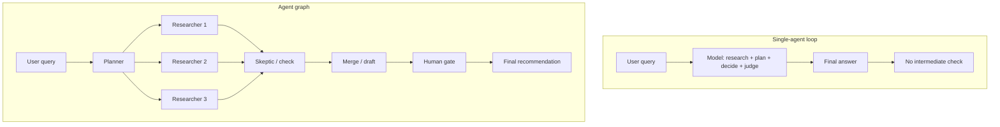
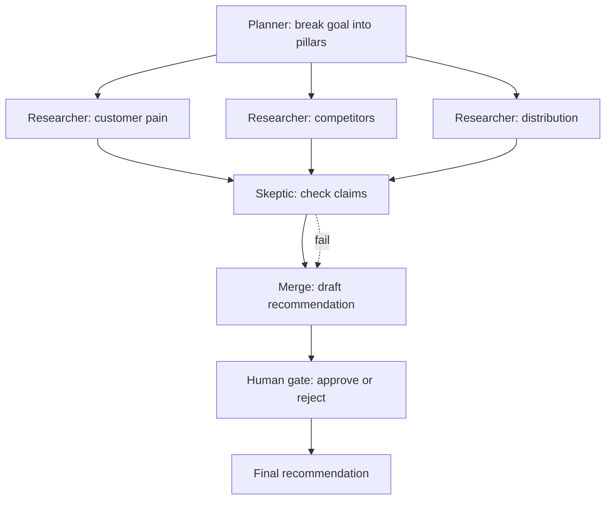
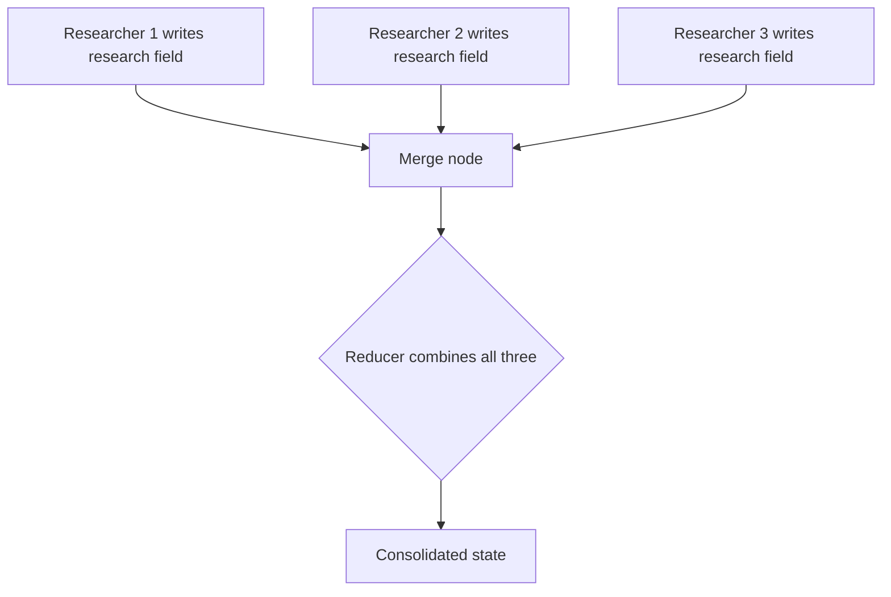
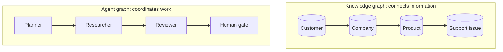
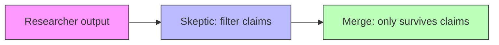
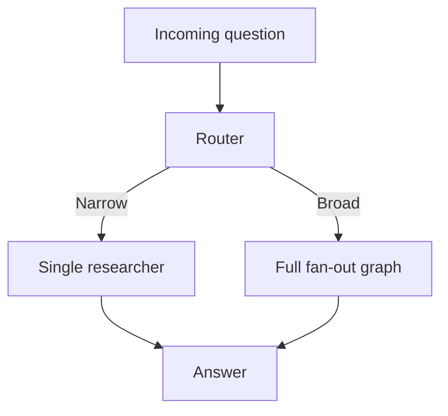
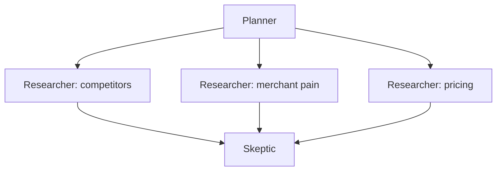
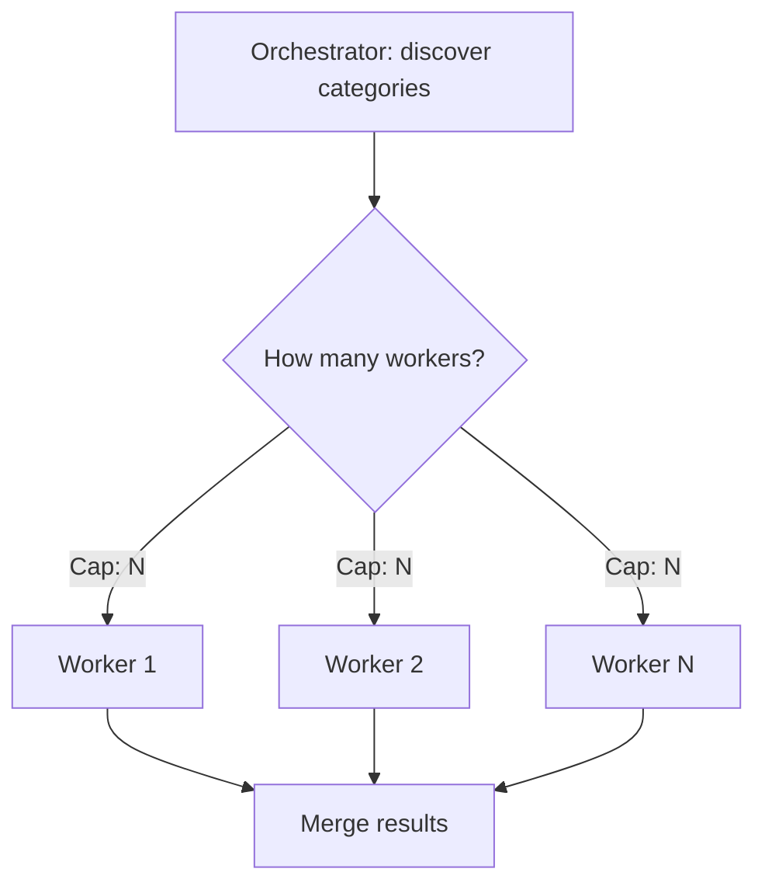
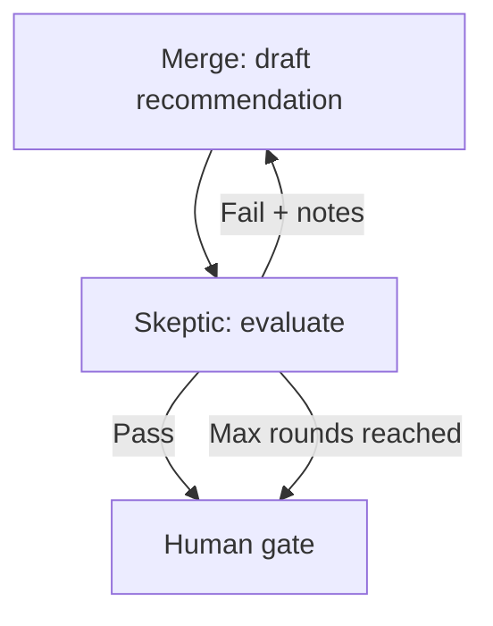

# Graph Engineering for AI Agents: From Prompts and Loops to Workflows

A viral debate over loops versus graphs points to a bigger shift in how we build AI systems. Here is what graph engineering actually means, how it differs from prompt, context, and loop engineering, and why it matters.

## 1. Introduction: From a viral debate to a graph you can build by hand this week

A twelve-word question circulated online: "Are we still talking loops or did we shift to graphs yet?" It is the kind of question builders ask each other in direct messages, not something that racks up replies from across the AI community. But it did, and an AI engineer answered it directly with an article titled "Loop Engineering Is Dead. Enter Graph Engineering."

A public debate started. Within days there were counterargument posts arguing loop engineering was not dead at all, explainer threads, and videos breaking down what the message actually meant.

A question arises for those using agentic AI:

> What is graph engineering and how does it help? How is it different from earlier techniques such as prompt engineering, context engineering, and loop engineering?

## 2. Who this is for

This is for people who already use AI for real, repeatable work — not just one-off prompts. Maybe you use it to research an idea, triage support tickets, review code, draft content, or make decisions from messy information. You have probably also seen where the simple "give it a task and let it loop" approach starts to break down: a check gets skipped, a weak answer gets accepted too early, or something that looked right on the first pass falls apart on the second.

You do not need to be building agents or working with an orchestration framework to follow along. The goal is to make the loops-versus-graphs debate concrete enough that you can see what actually changes in practice. By the end, you will be able to take one workflow you already run with AI, sketch it as a graph on paper, and decide whether adding structure would actually make it better.

## 3. The problem with single-agent loops

### 3.1 How is graph engineering different?

Here is a brief explanation of the differences.

- **Prompt engineering** optimizes what you say to a model.
- **Context engineering** optimizes what the model can see when it answers. Both still operate within a single turn.
- **Loop engineering** moves up a level. It gives the model tools, memory, and the ability to iterate — but control still lives inside one continuous run. The model decides what happens next.
- **Graph engineering changes who is in control.** Instead of letting the model manage the process as it goes, you define the nodes, routing logic, and checkpoints in advance. The model contributes judgment only at the steps that actually require it. The graph decides what happens next.

In short: from trusting a model to manage the entire process to trusting a structure to manage the process — and using models only where their judgment is genuinely needed.

### 3.2 Why a single-agent loop causes issues

Most people use AI in much the same way: open a chat, ask a big question, get a confident answer, and move on. Sometimes the answer seems right, sometimes it is too broad, sometimes it is incorrect. Then it has to be validated and rechecked over and over, without a fixed workflow or structure, which leads to inconsistent quality each time.

Imagine you are trying to validate a startup idea: should you build an AI bookkeeping tool for Shopify merchants?

You ask the model. It researches the market, finds a few competitors, sketches a go-to-market plan, and gives you something that looks like a finished memo. By the end, it feels like you have done the research, and the plan looks good.

But look at what actually happened.

One model decided what was worth investigating. Then it gathered the evidence, interpreted what it found, made a recommendation, and judged its own confidence in that recommendation. It did all of this in a single run, with no one checking its work along the way — no one confirming whether its initial direction was good enough, and no one catching where its reasoning went wrong.

That is the single-agent loop. It looks good on the surface, but the underlying process is flawed.

This is also what causes many of the problems we see when agents are used in real systems: they get stuck repeating unproductive steps, miss important business rules, or run out of context halfway through a task.

The answer is not a better prompt. It is a smaller job.

### Single-agent loop vs. graph

One thing from experience: if you already know a business rule or have domain knowledge, put it directly in code instead of hoping the model remembers it. Use the model only for the parts that actually require judgment — interpreting something ambiguous, comparing messy information, or choosing between possible next steps.

Do not give the model control over the entire workflow. Give it one clearly defined step at a time.

That is the idea behind graph engineering: instead of trusting one model to make an entire decision from start to finish, you build a workflow that determines what happens next. The model provides judgment where judgment is useful. The graph provides structure everywhere else.

Keep the Shopify bookkeeping question in mind. For the rest of this piece, we will build a graph around that question one piece at a time, until "structure instead of judgment" becomes something concrete you can actually see.

## 4. The building blocks of an agent graph

Strip away the diagrams, and an agent graph is surprisingly simple. It comes down to three core pieces: nodes, edges, and state. There are also a couple of things — reducers and checkpoints — that become important once you move from a demo to production.

- A **node** is one self-contained unit of work. It could be an LLM call, a human approval step, or a regular deterministic calculation. Not every node needs a model. Checking whether an invoice crosses an approval threshold does not need an LLM. Deciding whether an email is actually a refund request probably does.
- An **edge** decides what happens next. This is where most of the "graph" idea comes from: after one node finishes, where should the work go? Sometimes the next step is fixed. Sometimes it depends on the result. Sometimes one step fans out into several tasks that can run in parallel.
- **State** is the shared record that moves through the graph. It holds things like the original task, research gathered so far, drafts, intermediate results, and pass/fail verdicts from previous checks. Instead of stuffing the entire workflow into one growing chat history, each step reads from and writes to a structured state.

### Edge types

| Edge type | What it does | In the Shopify graph |
|-----------|--------------|----------------------|
| Direct | One step feeds straight into the next, no branching | Skeptic → merge, merge → human |
| Conditional | Routes to a different node based on the output before it | Would send a narrow question straight to one researcher, skipping the fan-out |
| Parallel | Fans a task out to several nodes at once | Planner → the three researchers |
| Looping | Sends a failing result back with the reason attached | Merge → skeptic → merge, the second-pass check |
| Error | Catches a broken node and routes to recovery logic | Not used here — e.g. a failed search call retrying before a researcher reports back |
| Human-controlled | Pauses the workflow until a person approves | The founder's gate before acting on the recommendation |
| Event-triggered | Waits on something outside the graph entirely | Not used here — e.g. a new competitor listing re-triggering research |

### Shopify graph flow

Now put those three pieces back into the Shopify example.

A planner node takes "Should I build an AI bookkeeping tool for Shopify merchants?" and breaks it into three pillars: customer pain, competitors, and distribution. From there, the graph fans out to three research nodes running in parallel. Their findings are added to the state. A skeptic node checks which claims actually hold up, and another node uses the surviving evidence to draft a recommendation.

That recommendation, along with the research and checks behind it, eventually reaches a human who decides what to do next.

That is the graph: nodes do the work, edges decide where the work goes, and state carries the information between them.

Two more concepts start to matter when you move from a diagram to a real production system: reducers and checkpoints.

A **state reducer** matters when parallel branches come back together. Imagine three researchers finishing at roughly the same time and all trying to update the same research field. You do not want whichever finishes last to silently overwrite the others. A reducer defines how those results should be combined — merging lists, combining dictionaries, or otherwise resolving conflicting updates.

### Reducer collision

A **checkpoint** is a snapshot of the graph's state at a particular moment. It sounds optional until a forty-minute workflow crashes at minute forty. With checkpoints, you can resume from the last saved state instead of paying to run the entire workflow again.

Some frameworks pair checkpoints naturally with interrupts. A workflow can pause while waiting for human approval and later continue from the same state using the same thread identifier. This is what makes long-running, human-in-the-loop workflows practical rather than just possible.

There is one production detail worth remembering: be careful with side effects around retries and interrupts. If a node sends an email, charges a card, or performs another external action before the workflow pauses, that action should be idempotent. Otherwise, resuming or retrying the workflow could accidentally perform it twice.

## 5. Two different things people call "graph"

The word "graph" gets used for two different ideas in AI, which is where some of the confusion around graph engineering comes from.

### Knowledge graph

A knowledge graph is about how information connects.

For example: this customer works at this company, this company uses this product, this support issue is related to this feature, and this feature belongs to that team.

This is the idea behind retrieval systems that make relationships explicit. Traditional retrieval-augmented generation is good at finding pieces of text that are similar to a question. But it can struggle when the answer depends on connecting information spread across different documents or sources. A knowledge graph makes those relationships explicit.

In simple terms, knowledge graphs organize relationships between information.

### Agent graph

An agent graph is different: how work moves through a system.

In an agent graph, a planner breaks a goal into tasks. Researchers work on those tasks in parallel. A reviewer checks what they found. A synthesizer combines the useful evidence. A human approves the final result before anything happens. That is the same structure as the Shopify example above.

Everything discussed so far — nodes, edges, state, and transitions — belongs to this second category.

A simple way to remember the difference:

> Knowledge graphs connect information. Agent graphs coordinate work.

However, both can be used by a system. A knowledge graph might help an agent understand how pieces of information relate, while an agent graph determines what the system should do with that information and what happens next.

For the rest of this piece, when graph engineering is discussed, it refers to the second one: designing the flow of work around AI agents.

### Graph comparison

## 6. Five patterns for graph engineering

You do not need a custom architecture for every AI workflow. Most production workflows come down to a handful of recurring patterns. Each solves a different problem, and each has its own failure mode.

Here is how five of the most useful patterns fit into the same Shopify graph.

### 6.1 Prompt chaining

Prompt chaining means the output of one node becomes the input to the next. You can think of this as an assembly line, where each station only touches what the last one handed off, and is never given the whole car.

In the graph, the skeptic produces a short list of which claims survived and which did not. That list becomes the merge node's input. The merge node does not need to see all the researchers' raw notes: the tangents about integrations, half-relevant forum threads, or pricing pages that turned out not to matter.

That separation is important. Each node gets only the context it needs to do its job, instead of carrying the entire conversation forward.

This is one of the main reasons chaining works better than one long chat. A research step can accumulate a lot of noise, and passing all of it downstream makes the next step harder, not easier.

There is also a simple test for when not to use chaining: if the next node genuinely needs everything the previous node saw, splitting them may not buy you much. You may just be adding another model call and more latency.

### 6.2 Routing

Routing decides which path an input should take. Think of it like hospital triage: assess each case once, then send it to the right specialist instead of putting every patient through every department.

Suppose the founder asks a much narrower question:

"Should I add invoice sync to my existing tool?"

That is different from:

"Should I build a bookkeeping product for Shopify merchants?"

A router in front of the planner can recognize the first question as narrow and send it directly to one researcher instead of launching the full research workflow.

The benefit is simple: you match the amount of work to the difficulty of the question.

The danger is misclassification. If the router mistakes a broad question for a narrow one, nothing necessarily breaks. The workflow can still return a polished, confident recommendation — it just happens to be based on a fraction of the research it actually needed.

That is why routing needs guardrails. Test the router against labeled examples, and when its confidence is low, send the request down the broader path rather than the cheaper one.

### 6.3 Parallelization

Parallelization is useful when several independent pieces of work can happen at the same time — like three analysts working toward the same deadline, each handling a separate, predefined piece of the work simultaneously.

That is already happening in the Shopify graph. Once the planner decides what needs to be researched, it can send separate questions to multiple researchers at once: one looks at competitors, another at merchant pain points, and another at pricing and willingness to pay.

Those researchers do not depend on each other, so there is little reason to run them one after another.

The advantage is speed. Three independent research tasks can run simultaneously and then feed their results into the skeptic or merge step.

But parallelization only works well when the branches are actually independent. If researcher B needs the result from researcher A before it can do useful work, they should not be parallel branches at all.

### 6.4 Orchestrator-workers

Orchestrator-workers is useful when the work needs to be divided, but the number of tasks is not known in advance. Imagine it like a contractor who assesses the job first, then decides how many subcontractors to assign and what each should handle, rather than starting with a fixed set of crew before seeing the work.

Suppose the founder now wants the Shopify idea checked against every adjacent alternative: competing apps, agencies, freelance bookkeepers, freelance services, spreadsheet templates, and anything else merchants are already using. You may not know how many categories matter until the workflow starts researching.

An orchestrator changes this by discovering those categories first, then creating a worker for each relevant one.

That is the key difference from normal parallelization. With parallelization, you already know you want three researchers. With orchestrator-workers, the workflow decides how many workers it needs while it is running.

However, that flexibility comes with a very practical risk. If the orchestrator discovers forty categories and launches forty model or API calls at once, you can quickly hit rate limits or blow through your budget. So put limits in place before execution: cap the number of workers, the total spend, or both.

### 6.5 Evaluator-optimizer

Evaluator-optimizer adds a feedback loop: one step produces an answer, another evaluates it, and the first step gets a chance to improve it. It works like an editor returning a draft to the writer with specific notes, then reviewing the revision before it ships instead of publishing the first pass.

Imagine the merge node produces its first recommendation and includes this claim:

"Shopify merchants will pay $50 per month."

The skeptic checks the draft and realizes none of the research actually supports that number. Instead of letting the recommendation continue to the human gate, it sends the draft back with a specific instruction: support the $50 claim with evidence or remove it. And the merge node gets another attempt.

But how does the checker know when to stop? That is where stopping rules come in. You can cap the loop at a fixed number of rounds or stop once a specific criterion is met. In this graph, we might allow two rounds of evaluation and revision, then stop regardless of the outcome.

The bigger problem, though, is a loop that keeps running without actually improving the result. If the second draft contains the same unsupported claim with slightly different wording, another round probably will not help.

That is not iteration. It is repetition.

A good evaluator-optimizer loop therefore needs two things: a maximum number of rounds and a way to detect when the output has stopped meaningfully improving.

## 7. Prove the shape before you automate it

Once this clicks, the instinct is to reach for LangGraph, AutoGen, or n8n. Do not. The structure matters more than the tooling, and you can test it in twenty minutes and a blank page.

Using the Shopify question, do the following first:

1. **Define the output in one sentence.** Not "help me research this," but "a one-page recommendation on whether this idea is worth testing." If you cannot define the output clearly, the workflow is not ready to become a graph.
2. **List the jobs a competent human would do.** For the Shopify example: clarify the question, research customer pain, research competitors, research distribution, check the evidence, and write the recommendation. Five to seven jobs is usually enough. If you have twenty, you probably have not found the real structure yet.
3. **Draw dependencies, not sequences.** If two jobs do not need each other's output, put them side by side. Customer and competitor research can run in parallel. The skeptic waits for the research. The final writer waits for the skeptic.
4. **Add one human gate where a mistake matters.** A private research memo might only need a quick review. A customer email, refund, or public post should stop for approval right before the action.
5. **Run the graph manually.** Play every role yourself, one prompt at a time, with a fresh chat for each node. Pass each output into the next node that needs it. It is deliberately slower than one long chat: you are testing whether the structure improves the result before automating anything.

If it is not visibly better than a one-shot answer, do not automate it. A faster average process is still average.

After three good manual runs, move one step up: have the planner write `plan.md`, each researcher write its own file, the skeptic write `review.md`, and the final step write `recommendation.md`. You now have a simple paper trail without adding much complexity.

Only then reach for a framework.

| Tool | Best for | Needs | Watch out |
|------|----------|-------|-----------|
| LangGraph | Checkpoints, persistence, human-in-the-loop approvals built in | Python or JS, a checkpointer backend | More infrastructure to run, and version churn to track |
| AutoGen's GraphFlow | Branching and conditional logic across steps | Python, agent framework | API surface still evolving fast |
| n8n / Make.com | Graphs that need to touch Slack, email, or a CRM directly | No-code setup, connector accounts | Less control over the agent's internal reasoning |

## 8. Conclusion

More agents do not automatically make a better system. Sometimes they just give you five confident agents arriving at the same wrong answer while the coordination overhead grows faster than the quality of the thinking.

The goal is not to build the biggest graph you can draw. It is to build the smallest one that does four things well: cuts real latency, keeps the checker separate from the doer, puts a human in the loop where mistakes actually carry a cost, and knows when to stop.

The Shopify question you started with — or whatever problem you have substituted for it — probably already has this structure hiding inside it. Right now, you are just asking one model to play every role at once. Make those roles explicit. Remove dependencies that do not need to exist. Run independent work in parallel. Then put yourself back into the workflow at the points where judgment, accountability, or an irreversible decision actually belongs to you.

This week, do three things in this order:

1. **Write the one-sentence output** your workflow is supposed to produce.
2. **List the five to seven jobs** a competent human would need to do to produce it.
3. **Run the workflow manually once** — one prompt per node, with a fresh chat for each — before automating anything.

That manual run is your test. If it does not beat your usual one-shot answer, you do not have an automation problem yet. You have a workflow-design problem. Fix the shape before you fix the tooling.

You do not need graph-based retrieval or a graph query language on day one, either. The underlying ecosystem will keep improving while you experiment: graph-based retrieval is getting more efficient, and graph query languages have joined SQL as standard database query languages. That is not a reason to wait for the tooling to mature.

It is a reason to start with the simplest version now.

Sketch the graph. Run it by hand. Keep what earns its place.

## Resources

- The original social post that started the discourse this piece opens with.
- The response article that answered it directly: "Loop Engineering Is Dead. Enter Graph Engineering."
- "Building Effective Agents" — source of the five-pattern taxonomy (prompt chaining, routing, parallelization, orchestrator-workers, evaluator-optimizer) used throughout this piece.
- Persistence documentation covering checkpoints, threads, and interrupts.
- Research on graph-based retrieval via dynamic community selection, source of an average token-cost figure.
- GraphFlow documentation, for branching and conditional logic across steps.
- Recognition of a graph query language as the first new ISO standard database language since SQL.
- n8n and Make.com — workflow-automation tools referenced for graphs that need to touch Slack, email, or a CRM.
- A background technical write-up on graph architecture for AI agent systems.