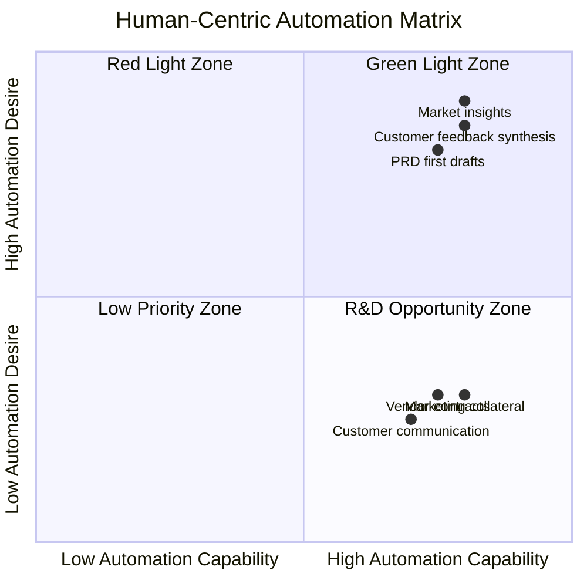

# A Human-Centric Framework for AI Adoption by Product Managers

A human-centric guide to AI automation for product managers.

In two decades as a product manager, I have never heard more concern about how the job will evolve or even exist than now with the emergence of AI agents. But let me be upfront: AI tools do not change the fundamental job of the PM, which is to identify the important problems to solve and guide the best ideas to implementation. AI agents can definitely augment and, in some cases, replace certain activities, and that is a good thing.

Do not give in to alarmist narratives of how your job will be negatively impacted. Each PM role is unique. While PMs share common aspects — create product concepts, define requirements, iterate with customers, go-to-market — the day-to-day work of a social media PM is very different from the work of a cloud infrastructure PM, requiring different aspects to be automated. As the mini-CEO of your product, only you decide what is needed for success. So you should be the one to decide how your job will evolve to make your product successful. You are in the driver's seat to choose what to augment or automate with AI agents to perform your job better.

A recent research study defines a useful framework for making these decisions and reveals that worker desire for automation is more of a defining factor for successful adoption than just technical feasibility.

## The Human-Centric Framework for AI Adoption

The study sheds light on ways AI agents can benefit work. It introduces the Human-Centric Automation Matrix, a 2x2 plotting Worker Desire against AI Capability, to help prioritize AI automation of PM tasks. Highlighting that workers want to automate tedious, repetitive tasks but are deeply concerned about losing control and agency. An overwhelming majority of workers in the study worried about accuracy and reliability of AI, with fear of job loss and lack of oversight as other concerns.

This trust deficit logically rules out full autonomous AI for high-stakes communication with customers or vendors. The preference is clearly for AI taking a partnership or assistive role. The study introduces the Human Agency Scale (HAS), to measure the degree of automation:

- **H1 (no human involvement):** The AI agent operates fully autonomously.
- **H2 (high automation):** The AI requires minimal human oversight.
- **H3 (equal partner):** Human and AI have equal involvement.
- **H4 (partial automation):** The AI is a tool that requires significant human direction.
- **H5 (human involvement essential):** The AI is a component that cannot function without continuous human input.

Most workers are fairly comfortable with the H3-H5 range, preferring AI to be a partner or a tool and not a replacement. The decision for the PM is not just what to automate but also to which degree to give up control to the AI agent.

The concept is explained better with a 2x2 matrix with Automation Capability on the X-axis and Automation Desire on the Y-axis. The four quadrants are classified as:

| Quadrant | Automation Capability | Automation Desire | Classification |
|----------|----------------------|-------------------|----------------|
| Green Light Zone | High | High | Top priority — automate now |
| Red Light Zone | High | Low | Proceed with caution — augment, do not replace |
| R&D Opportunity Zone | Low | High | Innovate to get the tech ready |
| Low Priority Zone | Low | Low | Defer — not worth automating |

### Automation matrix

The framework helps determine which jobs are possible and also have a high chance of getting adopted in the workplace.

## Putting the framework into action

Instead of blindly following mandates to "use AI agents," PMs should do what they do best — think strategically about what is best for the business. Use this 2x2 to identify the areas ripe for automation that will have the most impact and keep your team happily productive.

- **Green Light Zone:** These would be the top priority. Automating market insights, synthesizing customer feedback, and generating first drafts of PRDs are tasks that are both technically feasible and highly desired. They save time and reduce cognitive load, freeing you up to do higher-level strategic work.
- **Red Light Zone:** Proceed with caution. AI has the ability to automatically generate marketing collateral, manage customer communication, or deal with vendor contracts, but PMs are not ready to give up control on these high-stakes tasks. An error can have serious consequences and augmentation (H3-H4 on the HAS scale) may be the right option.
- **R&D Zone:** Need to innovate to get the tech ready to automate the job. While there is a high desire for automation but the tech is not ready, more investment is needed to get there.

Most importantly, take charge. The PM-to-engineer ratio is not improving anytime soon. Adding agentic capabilities to your toolkit is your best bet for scaling your impact. But drive with caution. To thrive and make yourself indispensable, you must be the one shaping the future of your role.

## Key takeaways

- **Prioritize desire over feasibility:** The Human-Centric Automation Matrix is a powerful tool. It enhances traditional tools (e.g., Impact/Effort, RICE, Kano) by considering adoption and trust, and not just capability. True success is in building AI tools that your team actually uses.
- **Think agency and not just automation:** Use the Human Agency Scale (H1-H5) to determine the level of automation. Data-heavy and repetitive PM tasks (e.g., market insights discovery, data-based prioritization) fall into the "Green Light" zone due to high worker desire and readiness for AI. These are also inputs to decision making, so necessary checks and balances are already in place in subsequent steps. Others may fall into just H4, as just being a tool. This approach is useful in managing risk and building trust.
- **Focus on augmentation in high-stakes areas:** Creative, strategic, or customer-facing tasks (aka "Red Light" opportunities) match well with augmentation strategy. While AI will generate options, analyze data, and provide insights, final decisions and communications must remain with humans.
- **Core PM skills are more valuable than ever:** AI agents will handle more of the information-focused activities. We need to further develop our uniquely human skills: strategic thinking, empathy, stakeholder management, and organizational leadership.

The future of product management will be shaped by the choices of forward-thinking PMs, not by just the AI's capabilities. The most successful and adopted approaches will be human-centric, focusing on what PMs actually need to excel. Those who master this strategic partnership with AI will not only survive but also define the future of the role.

## References

- "Future of Work with AI Agents: Auditing Automation and Augmentation Potential across the U.S. Workforce." arXiv preprint.
- "What workers really want from AI." Stanford Report.